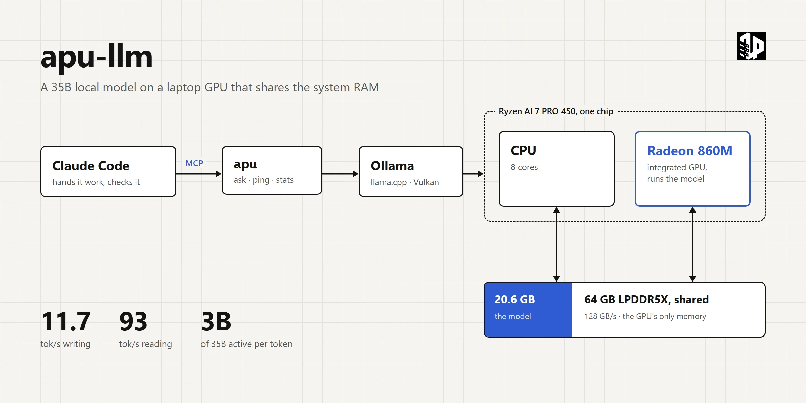
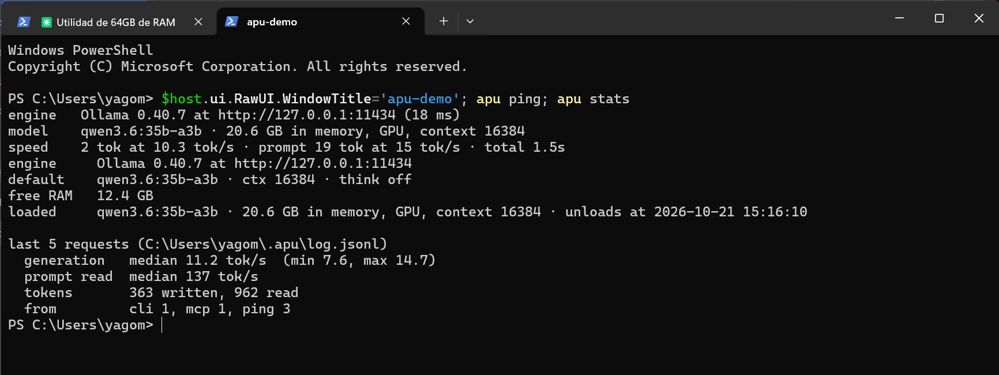
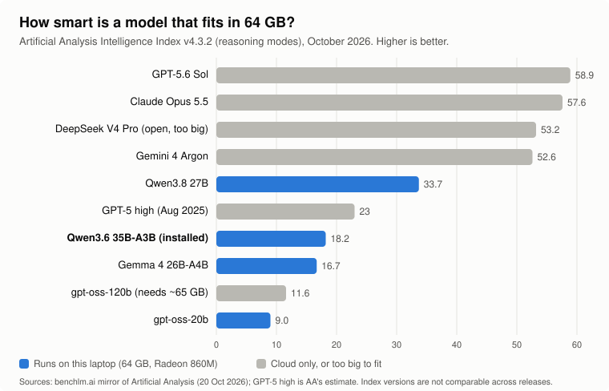
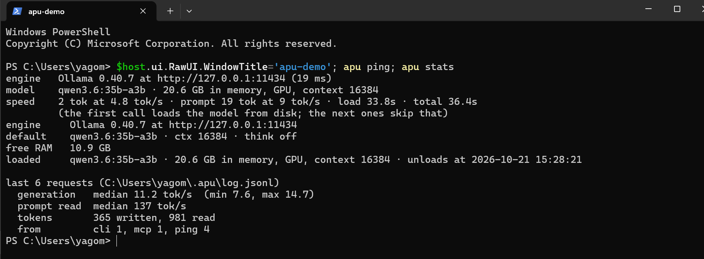
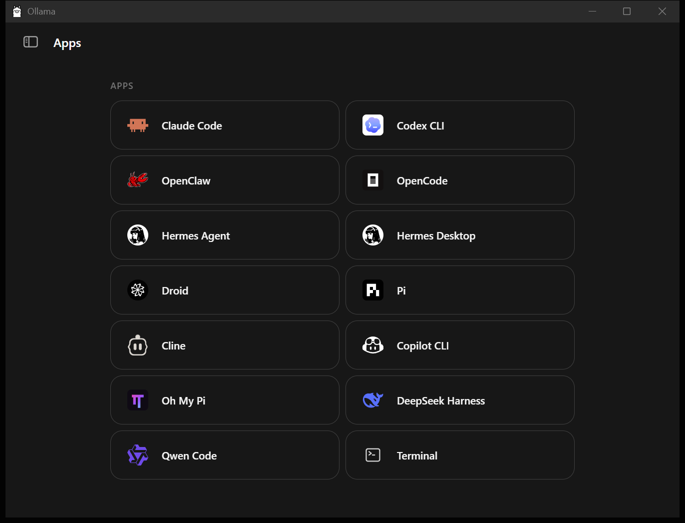
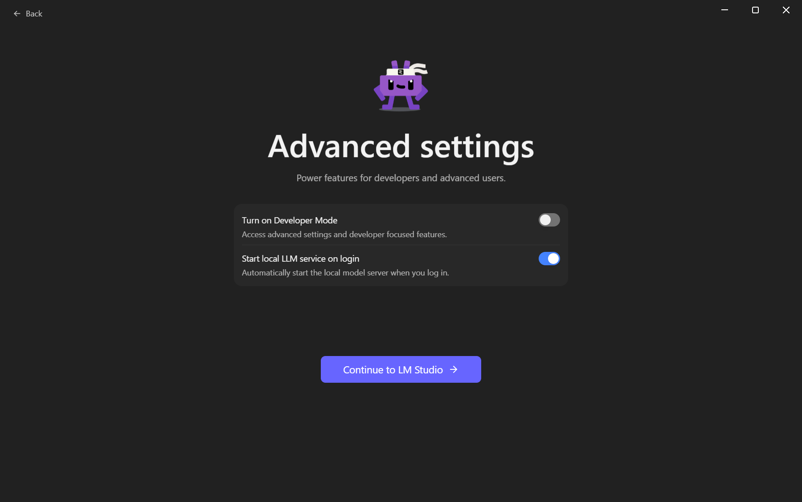

<p align="center">
  <a href="https://infraphysics.net"></a>
</p>

<h1 align="center">apu-llm</h1>

<p align="center">
  Local LLMs on laptops whose GPU shares the system RAM.<br>
  One command to set it up, ask it things, measure it, and let Claude Code hand it work.
</p>

<p align="center">
  <a href="LICENSE"></a>
  <a href="LICENSE-CONTENT"></a>
</p>

<p align="center">
  <b>A side project of <a href="https://infraphysics.net">InfraPhysics</a>.</b>
  The full write-up, every decision and why, is on <a href="https://infraphysics.net/blog/bits2bricks/local-llm-on-an-integrated-gpu"><b>infraphysics.net</b></a>
</p>

<p align="center">
  
</p>

I bought a ThinkPad with 64 GB of RAM and no graphics card, and wanted to know what that memory is worth for AI. The answer turned out to be this repository: on a laptop whose GPU borrows the system RAM, a 35-billion-parameter model fits whole on the GPU, runs offline, and takes bulk text work off Claude Code's hands. Everything here was measured on that one machine on 21 October 2026, including a conclusion I got wrong and withdrew. Why the GPU has no memory of its own, why Ollama and not LM Studio, why nothing is reserved for the GPU, and whether 64 GB were worth paying for, are in the article on [**infraphysics.net**](https://infraphysics.net/blog/bits2bricks/local-llm-on-an-integrated-gpu); the step-by-step log is in [`docs/journal.md`](docs/journal.md).

---

## TL;DR

- **Your laptop has no graphics card, but it has a lot of RAM.** On an APU (CPU and GPU on one chip) the GPU borrows system memory, so 64 GB of RAM is, in practice, up to ~48 GB of video memory. That is more than any consumer NVIDIA card has, and it is what lets a 35-billion-parameter model run on a thin laptop.
- **One line installs everything** on Windows: Python if missing, the `apu` command, Ollama, the switch that makes Ollama use the integrated GPU (it ignores it by default), and the right model for your RAM.
- **Then it is one command**: `apu ask`, `apu ping`, `apu stats`, `apu bench`, `apu doctor`.
- **Claude Code can hand it work** through a built-in MCP server: summaries, extraction, bulk drudgery, anything private. The local model drafts; Claude checks.

```powershell
irm https://raw.githubusercontent.com/yago-mendoza/apu-llm/main/install.ps1 | iex
```

<p align="center">
  
</p>

## What to expect, measured

Reference machine: Lenovo ThinkPad (21YW), Ryzen AI 7 PRO 450, Radeon 860M, 64 GB LPDDR5X-8000, Windows 11. Q4_K_M weights, context 16k, thinking off, temperature 0, a random prefix on every prompt so no engine reuses a cache, and the GPU/CPU placement read back from the engine after each run. Raw results in [`bench/results/`](bench/results), the full log in [`docs/journal.md`](docs/journal.md).

| Model | Engine, device | Writing | Reading a long prompt |
|---|---|---|---|
| **Qwen3.6 35B-A3B** (MoE, 3B active) | **Ollama, iGPU** | **11.7 tok/s** | **93 tok/s** |
| | Ollama, CPU only | 11.2 tok/s | 53 tok/s |
| | LM Studio, iGPU | 9.4 tok/s | 83 tok/s |
| **Qwen3.8 27B** (dense) | Ollama, iGPU | 2.6 tok/s | 13.8 tok/s |
| | Ollama, CPU only | 2.2 tok/s | 9.1 tok/s |

What that means in practice:

- **Qwen3.6 35B-A3B is the everyday model.** It writes about as fast as you read, reads a 3,000-word document in half a minute, and leaves room for a browser and an editor in 64 GB (20.6 GB loaded).
- **Qwen3.8 27B is much smarter and much slower.** A short answer takes a minute or two; a long document takes minutes just to read. Use it for short, hard questions.
- **The iGPU's win is reading, not writing.** At writing it ties the CPU; at reading long input it is 1.8× faster. Both run well below the memory's theoretical bandwidth.

<p align="center">
  
</p>

**How smart is it?** Below the frontier, honestly. On the Artificial Analysis Intelligence Index (v4.3.2, reasoning modes), Qwen3.6 35B-A3B scores 18.2 against 57.6 for Claude Opus 5.5 and 23 for the GPT-5 of August 2025; Qwen3.8 27B scores 33.7. It hallucinates when it does not know (about half the time on AA-Omniscience). Good for summarising, classifying, extracting, translating and first drafts; check its facts.

## Commands

```text
apu ask "question"             ask the local model
apu ask "fix this" -f app.py   with one or more files as context (-f repeats)
cat log.txt | apu ask "why?"   or piped input
apu ask --think "hard one"     let it reason first (slower, better)
apu ask --json ...             one JSON object: text + timings, for scripts
apu ping                       alive? which model, where loaded, how fast right now
apu stats                      loaded model, free RAM, median speed of recent requests
apu bench                      repeatable benchmark, saved with your machine's specs
apu models / apu use <model>   downloaded models / change the default
apu doctor                     checks every piece, prints the fix for each failure
apu setup                      installs and configures (Windows)
apu mcp                        the MCP server for Claude Code
```

<p align="center">
  
  <br><sub>After five idle minutes Ollama frees the memory, and the next call pays 34 s to read the model back from disk. <code>apu ping</code> says so.</sub>
</p>

Timings go to stderr, the answer to stdout, so `apu ask ... > answer.md` stays clean. Every request is logged to `~/.apu/log.jsonl`; `apu stats` summarises it. Settings live in `~/.apu.json` (`model`, `ctx`, `think`, `host`) and can be overridden per shell with `APU_MODEL`, `APU_CTX`, `APU_THINK`, `APU_HOST`.

## Claude Code

`apu setup` registers the MCP server if Claude Code is installed. By hand:

```powershell
claude mcp add --scope user apu -- "$(Get-Command apu | % Source)" mcp
```

Claude Code then has two tools in every project: `local_llm_ask` (a prompt plus file paths) and `local_llm_status`. The tool description tells Claude what the local model is good for and to check what it returns. A real first run, with the local model's summary and Claude's review of it, is in [`docs/evidence/claude-code-delegation-2026-10-21.md`](docs/evidence/claude-code-delegation-2026-10-21.md): the shape was right and four facts were wrong, and Claude caught all four.

## What the installer does for you, and why

Each of these cost time on the reference machine. The journal has the logs.

- **Ollama ignores integrated GPUs by default.** Its log says `dropping integrated GPU; to enable, set OLLAMA_IGPU_ENABLE=1`, and the model then runs on the CPU. ROCm does not help either: the 860M is `gfx1152`, which Ollama's ROCm build does not support. Vulkan does, once the switch is on. `apu setup` sets it.
- **The context default is huge.** With 47.6 GB counted as video memory, Ollama defaults to 262,144 tokens of context, whose cache costs gigabytes. `apu` asks for 16,384 per request.
- **pip puts `apu.exe` outside your PATH.** The installer adds pip's user Scripts folder.
- **No dedicated video memory is reserved.** AMD's *Variable Graphics Memory* would take RAM away from Windows permanently, needs a reboot each way, and the measurements here do not point at shared memory as the bottleneck. Not tested; an open question.

## Which machines

The guide is about **APUs with unified memory**: the GPU has no memory of its own and uses system RAM. What matters is the RAM size (what fits) and its bandwidth (how fast it runs), far more than the brand.

| Family | iGPU | Status |
|---|---|---|
| AMD Ryzen AI 400 / 300 (Gorgon Point, Strix Point) | Radeon 860M, 880M, 890M | **Measured** (860M, 64 GB) |
| AMD Ryzen 7040 / 8040 (Phoenix, Hawk Point) | Radeon 780M, 760M | Expected to work the same way; not measured |
| AMD Ryzen AI Max (Strix Halo) | Radeon 8060S | Same recipe, ~2× the bandwidth; not measured |
| Intel Core Ultra (Lunar Lake, Arrow Lake, Panther Lake) | Arc iGPU | Ollama's Vulkan path should apply; not measured |

Which model to run, by installed RAM (what `apu setup` picks):

| RAM | Default model | Why |
|---|---|---|
| 48 GB or more | `qwen3.6:35b-a3b` | Best intelligence per active parameter that fits with room to spare |
| 28 to 47 GB | `gemma4:26b-a4b` | MoE, ~4B active, smaller footprint |
| 14 to 27 GB | `gemma4:e4b` | Small and fast |
| less | `gemma4:e2b` | Smallest that is still useful |

Ran it on another machine? `apu bench` writes a JSON file with the machine's specs to `~/.apu/bench/`. A pull request adding it to `bench/results/` extends the table.

## Reference

- [`docs/journal.md`](docs/journal.md): the build, in order, with evidence for each step, including a conclusion that had to be withdrawn and why.
- [`docs/evidence/`](docs/evidence): engine logs and transcripts quoted in the journal.
- [`docs/assets/screens/`](docs/assets/screens): screenshots of every step.
- [`tools/compare_engines.py`](tools/compare_engines.py): the same weights and prompts through Ollama and LM Studio, with engine-side timings.
- [`tools/capture.ps1`](tools/capture.ps1): captures one window (never the whole screen) for the screenshots.
- `src/apu/`: the command, standard library only. `ollama.py` talks to Ollama's native API, which reports engine timings and the GPU/CPU split; `mcp.py` is a minimal MCP server over stdio.

<table>
  <tr>
    <td width="50%"></td>
    <td width="50%"></td>
  </tr>
  <tr>
    <td><sub><b>Ollama</b>, the engine used here: a background service with an API. Its app also launches coding tools against the local model.</sub></td>
    <td><sub><b>LM Studio</b>, the cross-check: same llama.cpp underneath, a desktop app first, the GPU found without any switch.</sub></td>
  </tr>
</table>

Ollama and LM Studio both run models with ggml/llama.cpp from GGUF files; this repo uses Ollama as the engine (faster here on identical weights, open source, a service with an API) and LM Studio as a cross-check. The two can share one copy of the weights through a hard link: `lms import --hard-link <gguf>` (the default `lms import` *moves* the file).

## License and citation

- **Code** (`src/`, `tools/`, `install.ps1`): [MIT](LICENSE).
- **Content** (guide, journal, measurements, figures, screenshots): [CC BY 4.0](LICENSE-CONTENT).
- The Qwen3.6 benchmark figure in `docs/assets/external/` is Alibaba's, from the [model card](https://huggingface.co/Qwen/Qwen3.6-35B-A3B); the intelligence-index figures are Artificial Analysis's, via [BenchLM](https://benchlm.ai/benchmarks/artificialanalysis).

Cite as: *Yago Mendoza, «apu-llm», https://github.com/yago-mendoza/apu-llm, CC BY 4.0.*
